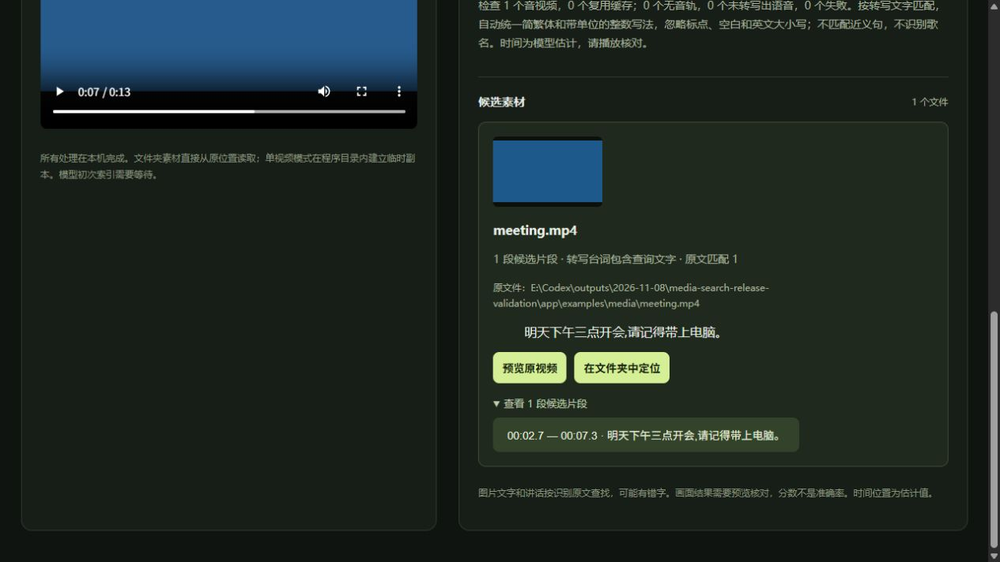

# Local Media Search · 镜头索引

**Remember the content, but not the filename? Search local photos, video moments, screenshot text and spoken lines.**

[简体中文](README.zh-CN.md) · v0.1.0 beta · Windows / Python 3.12 · Local inference · No paid API

| What you remember | Mode | What you get |
|---|---|---|
| A scene, object or appearance | 找画面 / Visual search | Matching files and candidate video moments |
| Words in a screenshot | 找图片文字 / Screenshot text | Recognized text and highlighted lines |
| Something said in a recording | 找讲话 / Speech | Transcript, original file and playable estimated ranges |

Search a whole folder recursively without picking a file first. Search visual moments inside a single long video too. Preview originals, reveal files in Explorer, and reuse cached indexes. The current UI is in Chinese; visual queries support Chinese and English.

## Real application walkthrough

These screenshots use fictional fixtures included in this repository, rather than private media or mock search results.




[Try the small reproducible example](examples/README.md). These fixtures are functional checks, not an accuracy benchmark. See [evaluation scope and results](docs/EVALUATION.md) for historical natural-recording tests.

## Quick start (Windows)

Install Python 3.12, download and extract this repository, then open PowerShell in its directory:

```powershell
python -m venv .venv
.\.venv\Scripts\python.exe -m pip install torch torchvision --index-url https://download.pytorch.org/whl/cpu
.\.venv\Scripts\python.exe -m pip install -r requirements.txt
.\start_local.cmd
```

Open http://127.0.0.1:8765/. Keep the terminal open while using the app; Ctrl+C stops it. On later runs, double-click `start_local.cmd`.

1. Select folder mode and a search mode.
2. Browse to or paste a media directory, then scan it.
3. Enter a description, screenshot text or spoken words, search, and preview the candidates.

Rescan after changing modes. Single-video upload currently supports visual search only; use folder mode for speech. The app chooses internal object/scene capabilities and thresholds automatically.

## Cost and privacy

- Processing runs locally; original files are not changed. Single-video uploads create a temporary copy.
- First use downloads models: approximately 1.5 GB for visual search and 0.5 GB for speech, plus 74–167 MB for object detection and an optional 109 MB dog verifier. OCR weights come with the dependency package.
- Initial indexing and transcription can be slow. Unchanged files reuse cached results. Speech currently runs on CPU with int8 inference.
- `.cache` includes models, indexes, OCR text and transcripts, potentially containing private information. Do not share or commit it. Delete it after stopping the app to clear caches; later runs rebuild/redownload them.
- For NVIDIA visual acceleration, use a matching CUDA build from the [official PyTorch installation instructions](https://pytorch.org/get-started/locally/). CPU-only use is supported.

## Limitations

- Candidates may be wrong or missing. Scores are not probabilities of correctness.
- OCR and speech use text matching, not semantic paraphrase retrieval. Speech matching normalizes Chinese script variants and selected integer quantities with units. Noise, accents and transcription errors affect recall.
- Speech timestamps are estimates clipped to the decoded audio duration, not exact editing boundaries. This version rebuilds old speech caches once to discard out-of-range timestamps.
- No song identification, environmental-sound search, identity recognition or automatic clip export. Exact game-map names, short actions, negation and spatial relationships are unreliable.
- The 80-category object detector applies to supported category queries in photo-only folders. Mixed folders and videos use visual similarity.
- Up to 50 files and 50 ranges per file are displayed; totals are shown separately. Changed files require rescanning. No cancellation, directory watcher or background queue yet.
- Validated on Windows / Python 3.12; other systems are unverified. Browser playback depends on codecs. This is a local single-user service.

Photos: JPG/JPEG, PNG, WebP, BMP. Videos: MP4, MOV, MKV, AVI, WebM, M4V. Speech also accepts WAV, MP3, M4A, FLAC, OGG, AAC, WMA and Opus.

## Development and contributing

```powershell
.\.venv\Scripts\python.exe -m pip check
.\.venv\Scripts\python.exe -m unittest discover -v
```

The development environment passes 94 tests, including timestamp-boundary regression. Tests do not measure model accuracy. See [release validation](docs/RELEASE_VALIDATION.md), [changes](CHANGELOG.md) and [contribution guidelines](CONTRIBUTING.md). Priorities are cancellation/retry, initial indexing and real-media regression.

Application source is [MIT licensed](LICENSE). Inspired by [semantic-video-search](https://github.com/David-Ykz/semantic-video-search), independently implemented, and not its official version. See [provenance](docs/PROVENANCE.md) and [third-party notes](THIRD_PARTY.md). Dependencies and model weights retain their own terms.
