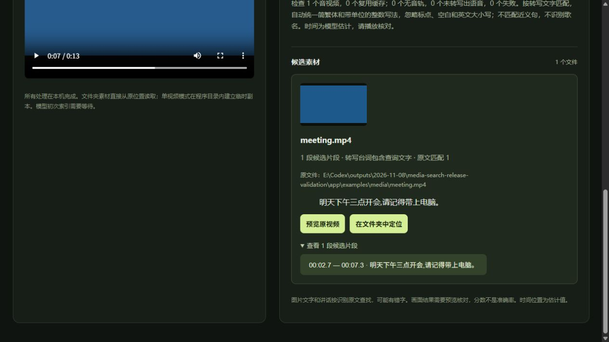

# 镜头索引 · Local Media Search

**记得内容，忘了文件在哪？用中文搜索本地图片、视频画面和音视频台词。**

[English](README.md) · v0.1.0 测试版 · Windows / Python 3.12 · 本地推理 · 无需付费 API

| 你记得什么 | 选择入口 | 得到什么 |
|---|---|---|
| “雪地里的狗”、自行车等画面 | 找画面（推荐） | 文件夹中的候选图片、视频，以及视频候选时间段 |
| 截图里写过“明天下午三点开会” | 找图片文字 | OCR 原文和命中的整行位置 |
| 视频或录音里说过“带上电脑” | 找讲话 | 转写原文、原文件和可播放的估计时间段 |

递归搜索整个文件夹，无需先挑中单个素材。也可在单个长视频中搜索画面。结果可预览、展开片段、定位原文件；未改变的文件复用缓存。

右上角可以切换 **简体中文** 或 **English**。界面会记住你的选择。

## 看实际效果

以下来自真实程序运行，使用仓库内虚构测试素材，不是效果示意图。




[跟着小样例操作](examples/README.md)。样例用于确认功能接通，不代表真实素材准确率；历史自然录音测试见[评测说明](docs/EVALUATION.md)。

## 安装与启动

安装 Python 3.12，下载并解压仓库，在项目文件夹打开 PowerShell：

```powershell
python -m venv .venv
.\.venv\Scripts\python.exe -m pip install torch torchvision --index-url https://download.pytorch.org/whl/cpu
.\.venv\Scripts\python.exe -m pip install -r requirements.txt
.\start_local.cmd
```

浏览器打开 http://127.0.0.1:8765/。以后双击 `start_local.cmd` 启动；使用期间保留终端，按 Ctrl+C 停止。

1. 选择“文件夹找素材”，选择检索方式。
2. 浏览或粘贴素材文件夹，点击扫描。
3. 输入画面描述、截图文字或说过的台词，搜索并预览结果。

切换检索方式后请重新扫描。单视频模式当前仅支持画面搜索；找台词请扫描视频所在文件夹。人物、物体等内部能力自动选择，不需要设置相似度阈值。

### 使用成本与隐私

- 素材在本机处理，原文件不修改；单视频上传会建立临时副本。
- 首次使用需要联网下载模型：画面模型约 1.5 GB，语音模型约 0.5 GB；物体检测另外下载约 74–167 MB，强配置的狗类别复核约 109 MB。OCR 模型随依赖安装。
- 首次建索引、首次语音转写较慢；文件未变时复用缓存。语音目前默认 CPU int8，未接入语音 GPU 加速。
- `.cache` 含模型、索引、OCR 文字和转写台词，可能含私人内容，请勿提交或分享。退出程序后可删除它来清理缓存，下次使用会重建或重新下载。
- NVIDIA 画面加速请按 [PyTorch 官方说明](https://pytorch.org/get-started/locally/)安装匹配的 CUDA 构建；无显卡也能运行。

## 已知限制

- 结果是候选，可能误检、漏检；相似度分数不是正确率。
- OCR 和语音按识别文字匹配，不是近义句搜索；语音统一简繁体及部分带单位整数写法。错字、方言、噪声和背景音乐会影响效果。
- 语音时间段是模型估计，已限制在音轨时长内，仍需播放核对，不是精确剪辑边界。升级本版后旧语音缓存需重新转写一次。
- 暂不支持歌名识别、环境声音、人物身份识别或自动剪辑导出；具体游戏地图、短暂动作、否定和精确位置关系不可靠。
- 80 类物体检测只用于纯图片库的标准类别查询，混合库和视频使用画面相似检索。
- 每次最多展示 50 个文件、每个文件 50 段，另显示总数。更改文件后需要重扫；暂无取消任务、目录自动监控和后台任务队列。
- 已验证 Windows / Python 3.12。其他系统未验证；浏览器播放取决于编码。服务仅供本机单用户使用。

图片：JPG/JPEG、PNG、WebP、BMP。视频：MP4、MOV、MKV、AVI、WebM、M4V。语音额外支持 WAV、MP3、M4A、FLAC、OGG、AAC、WMA、Opus。

## 开发、验证和贡献

```powershell
.\.venv\Scripts\python.exe -m pip check
.\.venv\Scripts\python.exe -m unittest discover -v
```

本版本开发环境通过 94 项测试，包含语音时间越界回归；测试不代表模型准确率。安装复验范围见[发布验证](docs/RELEASE_VALIDATION.md)，变更见 [CHANGELOG](CHANGELOG.md)。

下一步优先改善任务取消与重试、首次索引体验和真实素材回归。欢迎提交可复现问题，先阅读 [贡献说明](CONTRIBUTING.md)，不要上传私人素材或缓存。

项目源码采用 [MIT](LICENSE)。参考 [semantic-video-search](https://github.com/David-Ykz/semantic-video-search) 的文字检索视频思路，属于独立项目，非其官方版本；代码来源记录见[来源说明](docs/PROVENANCE.md)。第三方依赖和模型适用各自条款，详见 [THIRD_PARTY](THIRD_PARTY.md)。
